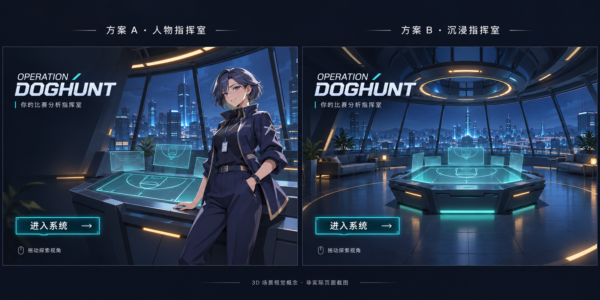

# Operation DogHunt｜3D 动漫启动页设计文档

版本：v1.0 · 2026-11-12  
用途：供用户审阅、视觉制作和前端开发使用。  
状态：视觉方向和基本交互已确认；本文补充设计建议与验收要求，页面尚未开发。

## 1. 要做出什么体验

用户打开网站，先进入一间可以转动视角的动漫指挥室。城市夜景环绕房间，中央全息篮球战术桌是视觉焦点。用户可以停留、拖动探索，也可以直接点击「进入系统」，打开现有 NBA 分析功能。

这个页面像系统的大门：让用户先感受到项目的世界观，再进入实际工作界面。进入操作不应依赖用户先学会控制镜头。

### 已确认的决定

| 项目 | 确定内容 |
| --- | --- |
| 视觉方案 | 方案 B「沉浸指挥室」：以无人空间为主 |
| 核心场景 | 科幻指挥室、环形落地窗、城市夜景、中央全息篮球战术桌 |
| 表现方式 | 网页实时呈现真实 3D 场景，转动时可看到物体不同侧面及遮挡变化 |
| 主要交互 | 鼠标拖动，围绕战术桌旋转观察；滚轮拉近、拉远 |
| 固定操作 | 项目名称与「进入系统」按钮固定在屏幕上，不跟随场景旋转 |
| 用户路径 | 打开启动页 → 浏览或直接点击进入 → 使用现有系统 |

**范围说明：** 本文中的具体色值、尺寸、镜头边界、动效时长及性能数值均为首轮制作建议，尚未逐项由用户确认。入口地址、重复访问行为和资产来源见第 10 节，不能把这些建议当成已获确认的最终选择。

## 2. 视觉参考

**采用图片右半部分「方案 B · 沉浸指挥室」。** 左侧人物方案仅用于保留对比背景，不进入本次设计范围。

参考图确定的是空间气质、构图和灯光方向。它是 AI 生成的概念图，不是已经完成的页面，也不包含可直接使用的 3D 模型。实现时需要制作或取得房间、桌子等立体资产，并补齐初始画面没有展示但旋转后会看到的部分。

## 3. 场景与美术设计

### 3.1 整体气质

关键词：安静、沉浸、科技感、动漫质感、有秩序。

采用 Cel Shading（卡通渲染）：物体有立体结构，但明暗分块清晰，像动漫中的光影。结合适度的金属、玻璃与地面反光，让房间有深度；保留可辨认的形体，避免整幅画面被霓虹光淹没。

### 3.2 空间分层

| 层次 | 内容 | 画面作用与要求 |
| --- | --- | --- |
| 前景 | 地面、少量控制台边缘 | 提供距离感；不能挡住战术桌或固定按钮 |
| 中景 | 中央战术桌、全息球场、辅助悬浮屏 | 主要视觉焦点，旋转时能看到桌体厚度和不同侧面 |
| 室内背景 | 环形窗框、顶灯、简洁座椅与少量植物 | 让房间完整可信；装饰密度低于中央桌面 |
| 室外远景 | 城市楼群、建筑灯光、夜空 | 形成空间纵深；亮度低于核心全息投影 |

中央桌面使用可辨认的篮球场线条。悬浮屏仅显示抽象图形和场地示意，不填入貌似实时的比分、盘口或胜率，避免用户误认为装饰数据是真实分析结果。

需要观察到立体变化的房间、战术桌、窗框和主要近景建筑，应有真实几何结构。足够远的天空等背景可采用适当的简化表现，但不能把整张概念图贴在背景上代替场景。

### 3.3 色彩建议

| 用途 | 建议色值 | 使用方式 |
| --- | --- | --- |
| 深色底 | `#081321` | 夜空、暗部、界面遮罩 |
| 室内主色 | `#14273B` | 墙体、桌体、窗框 |
| 主发光色 | `#49DDEB` | 全息球场、主按钮、关键灯带 |
| 暖色点缀 | `#E7AA62` | 顶灯与局部照明，少量使用 |
| 主文字 | `#EDF5FA` | 项目名称、主按钮文字 |
| 次要文字 | `#A7B9CA` | 操作提示 |

先保证战术桌、按钮和标题清楚，再增加反光与发光效果。按钮后方应有稳定的深色衬底，不能依赖当前镜头碰巧停在暗处。

## 4. 页面布局与文案

UI 指用户可以看到、点击的文字和按钮。页面由全屏 3D 画面与固定 UI 两层组成：转动的是房间，操作界面留在原位。

### 桌面布局建议

- 3D 场景铺满可视区域，初始镜头面对战术桌和窗外城市；桌面位于画面中下部。
- 项目标识位于左上区域，分两行显示 `OPERATION` 与 `DOGHUNT`。
- 标识下方放一句短文案，初稿为「你的比赛分析指挥室」。
- 「进入系统 →」位于左下区域，沿用概念图的位置和青蓝色轮廓；它是最醒目的操作按钮。
- 操作提示放在主按钮下方，文字为「拖动旋转 · 滚轮缩放」。
- 右下角提供次要操作「重置视角」，让用户随时回到初始构图。
- 首屏不显示现有系统侧栏、聊天框、盘口列表或后端连接状态。

建议桌面左右留白为 48–64 px，主按钮约 220–260 px 宽、52–60 px 高。实际尺寸按窗口调整，不用固定宽度强行撑开小屏幕。

### 移动端布局建议

手机保留真实 3D 场景，以竖屏重新安排镜头，让桌面完整可见。标题缩小置顶，进入按钮放在底部安全区域，避开系统手势条。单指拖动旋转，双指捏合缩放；提示改为「单指旋转 · 双指缩放」。具体操作需在实际设备验证后定稿。

## 5. 镜头与交互规则

### 5.1 围绕战术桌观察

Orbit 指镜头像系在桌子附近的一根绳子上，围着固定中心移动，始终朝向主体。本项目以战术桌中心附近为观察中心，不采用在房间中自由行走的方式。

| 操作 | 预期反馈 |
| --- | --- |
| 在空白场景区域按住鼠标并拖动 | 镜头绕桌子转动，物体遮挡与透视随之改变 |
| 在场景区域滚动滚轮 | 镜头靠近或远离桌子，观察中心保持稳定 |
| 松开鼠标 | 镜头轻微减速后停下，不持续自行旋转 |
| 点击「重置视角」 | 返回初始位置、方向与距离 |
| 点击「进入系统」 | 结束场景交互，进入现有系统 |

第一版建议允许完整的水平环绕，竖直观察范围和缩放距离设置边界，避免镜头穿墙、钻到地板下方、进入桌体或看见场景背面破洞。**完整环绕、具体边界与场景制作成本需在开发前确认。** 若最终采用受限角度，须明确说明可转范围，不能宣传为完整环绕。

桌面主体在最近和最远距离都应能识别；场景尽量通过房间结构和镜头边界解决遮挡。不要让「转到背面后只能看见墙」成为正常体验。

### 5.2 避免误操作

- 主按钮和重置按钮应拦住自身的拖动、点击事件，操作按钮时不能同时旋转场景。
- 场景拖动结束不能误触进入按钮。
- 滚轮缩放只作用于场景交互区域；不得全局禁止浏览器的页面缩放快捷键。
- 为按钮提供键盘焦点，按 Tab 可以选中，按 Enter 或空格可以操作。进入系统不依赖使用鼠标探索场景。
- 手机触控区域与按钮分开处理，避免点击按钮被当作旋转手势。

## 6. 动态氛围与进入流程

### 6.1 待机氛围

建议只保留少量缓慢运动：全息球场轻微明暗变化、少量屏幕线条移动、远处城市灯光稀疏闪动。主要桌体和房间保持稳定，文字与按钮不漂浮，不自动旋转镜头，不默认播放背景音乐。

用户选择减少动态效果时，停止非必要的循环运动，并缩短或取消镜头过渡。

### 6.2 页面状态

| 状态 | 用户看到什么 | 可执行操作 |
| --- | --- | --- |
| 正在加载场景 | 深色底或预览画面、标题、「正在准备指挥室…」 | 主按钮立即可用，允许直接进入系统 |
| 场景就绪 | 实时 3D 房间、操作提示 | 旋转、缩放、重置、进入 |
| 正在进入 | 主按钮反馈为「正在进入…」，停止重复点击 | 执行一次页面跳转 |
| 场景加载失败或设备不支持 | 静态预览及「当前无法显示 3D 场景，仍可进入系统」 | 手动重试场景，或直接进入 |
| 系统跳转失败 | 简短失败提示，恢复进入按钮 | 用户可以再次点击进入 |

加载进度只有在可测量时才显示百分比，不使用虚假的进度条。静态画面是异常时保留入口的方式，正常支持的设备仍必须呈现可操作的真实 3D。

### 6.3 点击进入

正常场景下，建议在点击后进行约 0.4–0.8 秒的短过渡：按钮反馈、场景轻微推进或淡出，然后显示系统。具体过渡形式属于制作建议，须保证从任意镜头角度进入时不穿过桌子或墙体。加载中、失败状态或减少动态效果模式直接进入，不强迫用户等场景完成。

进入后应停止场景渲染并释放资源，让显卡不再继续绘制看不见的房间。启动页不调用付费聊天或盘口刷新接口。

## 7. 与现有项目的衔接

2026-11-12 已检查当前源码：

- `frontend/src/router/index.ts` 中 `/` 是聊天页，`/matches` 是比赛页，记录、统计、记忆和设置各有独立地址。
- `frontend/src/App.vue` 在所有页面外包裹 `AppShell`（公共侧栏和顶部区域），并通过 `KeepAlive`（保留切页前组件状态的机制）缓存 `ChatView`。
- `frontend/package.json` 当前未声明 3D 渲染依赖。

启动页需要独立的全屏布局。具体开发方案应保留比赛选场进入聊天的行为，以及已有的跨页聊天状态，不应为增加启动页而清空用户对话或破坏现有路径。

**入口地址暂未定案。** 如果把 `/` 改成启动页，需要安排聊天的新地址并核对所有相关导航；如果保留聊天地址、另设启动入口，则需要明确用户打开网站时怎样先到启动页。两种方式对历史链接的影响不同，开发前与用户确认，不在本设计文档里擅自选定。

本轮只定义设计目标，没有新增依赖、修改路由、实现访问控制或调整后端接口。

## 8. 资产与性能要求

### 8.1 需要准备的内容

| 资产 | 要求 |
| --- | --- |
| 房间模型 | 包含窗框、墙面、地面与顶灯；可见范围与镜头转动范围一致 |
| 战术桌模型 | 体积结构清晰，各侧面完整，可近看 |
| 全息球场与悬浮屏 | 篮球场线条可辨，装饰图形无虚假实时业务含义 |
| 城市远景 | 分层表达距离，控制楼群细节与灯光数量 |
| 材质与贴图 | 材质控制物体的颜色、反光等外观；贴图是附着在表面的细节图片，需控制体积 |
| 异常与加载预览 | 可使用确认后的场景截图；当前对比图只是设计参考 |

尚未确认自制、委托制作或使用现成模型。发生采购费用或需要外部授权时，应先向用户说明来源、价格和用途。概念图不能自动变成这些可编辑的模型资产。

### 8.2 性能初始目标（待原型验证）

FPS 是每秒显示的画面数量，数值越稳定，拖动通常越顺畅。建议桌面以稳定 60 FPS 为目标，移动端以稳定 30 FPS 为起点；这些是目标，不是当前实测结果。

建议首轮将启动页新增的首屏必需资源压缩后控制在 10 MB 以内。在约 20 Mbps 下载速度的测试条件下，争取 5 秒内可操作；记录实际设备、浏览器、网络、传输体积和耗时后再决定是否调整预算。标题和进入按钮应尽早出现，不等待全部 3D 资源。

低性能设备可降低画面分辨率、反光和阴影复杂度，优先保留桌体、房间结构与旋转操作。页面隐藏时暂停持续绘制，离开启动页时释放资源。任何降级都应通过实机验证，不能只凭开发电脑判断手机表现。

## 9. 验收清单

以下是开发完成后要验证的项目，本轮没有执行页面验收。

- [ ] 初始画面能辨认出方案 B 的主要结构：无人指挥室、城市夜景、全息篮球战术桌。
- [ ] 拖动时能看到桌体不同侧面和真实遮挡变化，证明不是整张背景图移动。
- [ ] 旋转和缩放在确认的范围内正常，镜头不穿墙、不进入桌体、不落到地板下方。
- [ ] 重置能回到初始镜头；标题和进入按钮始终清楚可见。
- [ ] 按钮操作不会同时拖动场景；场景拖动不会触发进入。
- [ ] 加载中、正常状态和 3D 失败状态都可以进入现有系统，不强迫用户等待。
- [ ] 快速重复点击进入只触发一次有效跳转；跳转失败后可恢复操作。
- [ ] 现有比赛页、选场进入聊天、返回操作及跨页聊天保留没有回归问题。
- [ ] 桌面和手机布局没有横向溢出、按钮遮挡或安全区域冲突。
- [ ] 键盘可进入系统；减少动态效果设置生效。
- [ ] 页面切走后没有继续运行的场景绘制循环；没有自动调用付费聊天或盘口刷新。
- [ ] 在记录的设备和网络条件下给出实际性能数据，并说明未达目标项。

## 10. 开发前需要确认的事项

不必重新确认已选的方案 B 和围绕战术桌旋转。下面几项会改变制作量或使用习惯，应在对应工作开始前选择：

| 事项 | 待确认内容 | 为什么需要确认 |
| --- | --- | --- |
| 水平旋转范围 | 完整环绕，或限定在正面附近 | 决定是否要精细制作整个房间及桌体背面 |
| 入口地址 | `/` 改为启动页，或保留现有聊天地址并另设入口 | 影响历史链接与内部导航 |
| 重复访问 | 每次访问都展示，或同一标签页会话进入后跳过 | 影响日常使用是否需要反复点击 |
| 模型来源与预算 | 自制、委托制作或授权资产 | 决定画质、时间与费用；不默认批准采购 |

进入开发后，先用简单立体结构验证围绕观察、边界、固定按钮和系统跳转，再替换为正式美术资产。简单结构阶段只证明交互可行，不能作为方案 B 的最终视觉交付。

## 11. 文档与后续维护

本文件记录目标设计；当前已实现能力仍以 [CODEBASE.md](../CODEBASE.md) 和[前端模块说明](codebase/frontend.md)为准。后续如改变已确认方向，应在本文件记录日期与原因；实际修改页面行为后，再同步代码现状说明书和交接记录。

设计决定来源：[概念图与选择记录](handoff/2026-11-12-3D动漫启动页概念对比.md)。
